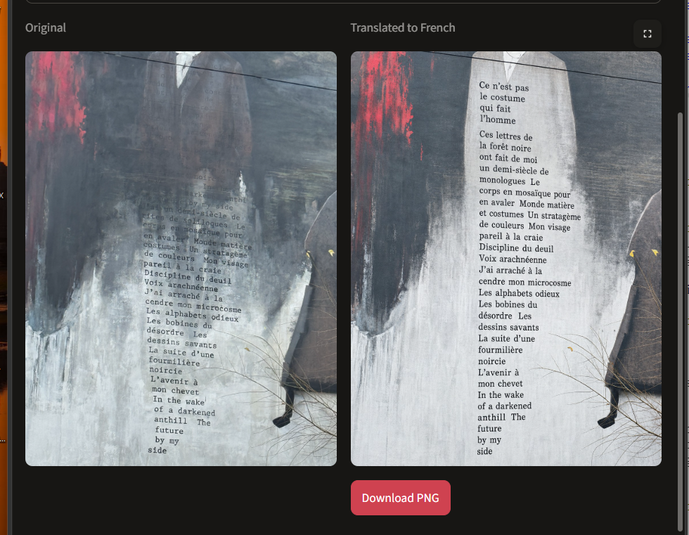

### ImageLingo App
#### Description
<p>ImageLingo is an app that translates texts of an image uploaded from one language to one of the targeted languages -English, French, or Mandarine. This app also keeps the originality of the image while improving lightings, removing shadows and enhancing readabilities of texts. The model powered this app is <b>gpt-image-2</b>. </p>

#### ImageLingo URL
<b>http://16.52.221.222</b>

#### Tech Stack
<ul>
<li>Python</li>
<li>FastAPI</li>
<li>OpenAI API</li>
<li>Streamlit</li>
<li>AWS LightSail</li>
<li>Git/GitHub/Github Actions</li>
<li>Caddy</li>
<li>Docker Compose</li>
</ul>

#### How to run the app locally
```bash
# 1. Navigate to desktop
cd ~/desktop
# 2. clone ImageLingo repo
git clone https://github.com/kun-2023/ImageLingo.git
# 3. Navigate to ImageLingo folder
cd ImageLingo
# 4. Create .env file
cp .env.example .env
# then replace your own OPENAI_API_KEY in .env file
# 5. build docker image_lingo
docker compose up --build
# 6. click http://localhost:8501
# And Enjoy!!!
```

#### Demo Images
|Demo 1|Demo 2|Demo3|
|:---:|:---:|:---:|
||||